<!-- ===================================================== -->
<!--                 FITRI RACHMANIA                       -->
<!--         RED · BLACK · WHITE  DEVELOPER PROFILE  v5     -->
<!-- ===================================================== -->

---

### ◈ &nbsp; ABOUT &nbsp; ◈

---

### ◈ &nbsp; TECH STACK &nbsp; ◈

 

 

---

### ◈ &nbsp; SELECTED WORKS &nbsp; ◈

━━━━━━━━━━━━━━━━━━━━━━━━━━━━━━━━━━━━
 
**01 &nbsp;▸&nbsp; [PORTOFOLIO-REACT](https://github.com/fedevhub/Portofolio-React "Personal portfolio")** &nbsp;REACT · VITE · BOOTSTRAP · SUPABASE
 
**02 &nbsp;▸&nbsp; [CRAVELY](https://github.com/fedevhub/Cravely "Web project dengan EJS")** &nbsp;EJS · JAVASCRIPT
 
**03 &nbsp;▸&nbsp; [ASTA PARIWISATA](https://github.com/fedevhub/asta-pariwisata "Web pariwisata dengan EJS")** &nbsp;EJS · CSS
 
**04 &nbsp;▸&nbsp; [LAVIDA](https://github.com/fedevhub/LAVIDA "Web project berbasis HTML")** &nbsp;HTML · CSS
 
**05 &nbsp;▸&nbsp; [UJIAN SEKOLAH FE](https://github.com/fedevhub/ujian-sekolah-fe "Frontend ujian sekolah")** &nbsp;JAVASCRIPT
 
**06 &nbsp;▸&nbsp; [LAPORAN PKL](https://github.com/fedevhub/Laporan-PKL "Hasil kerja selama PKL")** &nbsp;DOKUMENTASI
 
━━━━━━━━━━━━━━━━━━━━━━━━━━━━━━━━━━━━

**[→ LIHAT SEMUA REPOSITORY](https://github.com/fedevhub?tab=repositories)**

---

### ◈ &nbsp; GITHUB STREAK &nbsp; ◈

---

### ◈ &nbsp; CONTRIBUTION GRAPH &nbsp; ◈

---

**DESIGN FIRST** &nbsp;◆&nbsp; **CLEAN & SCALABLE** &nbsp;◆&nbsp; **ALWAYS LEARNING**

<!-- Ganti dengan link kamu, lalu hapus tanda komentar:

-->

OPEN TO CREATIVE IDEAS, PROJECTS & COLLABORATIONS &nbsp;·&nbsp; © 2026 Fitri Rachmania

